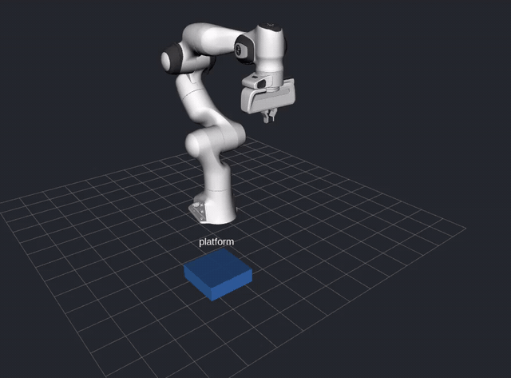
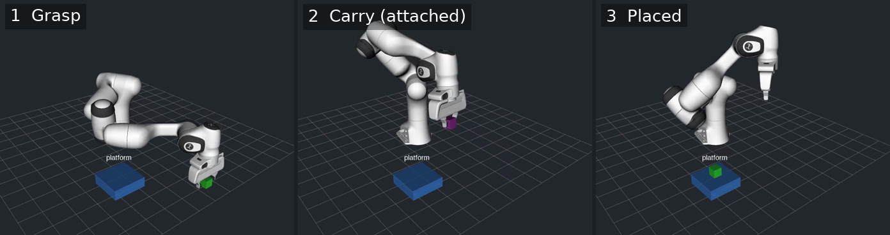

# ROS 2 Fault-Tolerant Pick-and-Place Pipeline

A ROS 2 (Humble) manipulation pipeline that drives a **Franka Emika Panda** arm through a full pick-and-place task using **MoveIt 2**. It finds the object through **TF2**, tracks it in the MoveIt planning scene while carrying it, uses straight-line moves near the object, monitors every motion with timeouts, and recovers automatically when a step fails.


<p align="center">
  
  <br>
  <sub>Recorded from an actual run of this pipeline in RViz (MoveIt 2 with ros2_control mock hardware), shown at 1.5× speed. The cube is a MoveIt collision object: <b>green</b> while it is in the world, <b>purple</b> while it is attached to the gripper. <a href="docs/media/pick_and_place.mp4">MP4 version</a></sub>
</p>



---

## Highlights

- **End-to-end pick-and-place:** a 12-step state machine (open, approach, descend, grasp, attach, retreat, traverse, descend, release, detach, retreat, home).
- **Perception through TF2:** object and place-target poses come from the TF tree at runtime, not from hard-coded values. A perception system could replace the simulated broadcaster without changing the motion code.
- **Planning-scene-aware grasping:** the object is added to MoveIt's planning scene as a collision object, attached to the hand at grasp (with the fingers as allowed touch links), and detached at release. Every plan, including the moves while carrying the object, accounts for it.
- **Correct tool-centre point:** MoveIt goals are set for the flange (`panda_link8`). An explicit 10.34 cm TCP offset makes the *fingertips*, not the flange, land on the object.
- **Two planners, each where it fits:** OMPL handles large free-space moves. The **Pilz `LIN`** planner gives straight-line Cartesian descend and retreat moves next to the object. If a straight-line plan is rejected, the node automatically falls back to OMPL for the same target.
- **Monitored execution:** every motion, gripper and planning-scene call has a timeout on both goal acceptance and result. If the result times out, the goal is actively cancelled so the arm never runs unsupervised.
- **Automatic recovery:** when a motion fails, the arm returns to a safe home pose and retries. If retries run out, the sequence stops cleanly with a clear log message instead of continuing from an unknown state.
- **Tested without a robot:** 26 pytest unit tests with mocked action servers, planning-scene service and TF buffer, plus clean ament `flake8`, `pep257` and copyright checks.
- **Reproducible environment:** a Dockerfile installs ROS 2 Humble, MoveIt 2, the Panda MoveIt config and ros2_control.

## Architecture

```
┌──────────────────────┐   TF2 (world → table → platform / object)   ┌──────────────────────┐
│  scene_broadcaster   │ ──────────────────────────────────────────▶ │   pick_place_node    │
│  (stands in for      │                                             │   (state machine)    │
│   perception)        │                                             └──┬───────┬───────┬───┘
└──────────────────────┘                                                │       │       │
                       /apply_planning_scene (add / attach / detach)    │       │       │ GripperCommand action
                ┌───────────────────────────────────────────────────────┘       │       │
                │                MoveGroup action (/move_action)                │       │
                ▼                ┌──────────────────────────────────────────────┘       ▼
       ┌──────────────────────────────┐                                     ┌─────────────────┐
       │  MoveIt 2 move_group         │ ──────── ros2_control ────────────▶ │  Panda arm +    │
       │  OMPL (free space)           │                                     │  gripper        │
       │  Pilz LIN (straight lines)   │                                     └─────────────────┘
       └──────────────────────────────┘
```

### Nodes

| Node | Purpose |
|------|---------|
| [`scene_broadcaster`](src/manipulation_pipeline/manipulation_pipeline/scene_broadcaster.py) | Publishes static `table` and `platform` frames and a live `object` frame over TF2, simulating a perception system. |
| [`pick_place_node`](src/manipulation_pipeline/manipulation_pipeline/pick_place_node.py) | Looks up the object and platform poses, adds the object to the planning scene, then runs the monitored pick-and-place sequence through MoveIt 2 and the gripper controller. |

### Pick-and-place sequence

| # | Step | Planner / interface |
|---|------|---------------------|
| 0 | add the object to the planning scene | `/apply_planning_scene` |
| 1 | `open-gripper` | GripperCommand |
| 2 | `approach-pick`: fingertips 10 cm above the object | OMPL |
| 3 | `descend-pick`: fingertips at the object's centre | Pilz LIN |
| 4 | `grasp`: close to the object's width | GripperCommand |
| 5 | `attach-object`: attach the object to `panda_hand` | `/apply_planning_scene` |
| 6 | `retreat-pick` | Pilz LIN |
| 7 | `approach-place`: move above the platform | OMPL |
| 8 | `descend-place`: object resting just above the platform | Pilz LIN |
| 9 | `release` | GripperCommand |
| 10 | `detach-object`: return the object to the world | `/apply_planning_scene` |
| 11 | `retreat-place` | Pilz LIN |
| 12 | `return-home` | OMPL |

Every motion goes through `_move_with_recovery()`: straight-line moves first fall back to OMPL, and then up to 2 attempts are made with a recovery move home in between.

<details>
<summary>Log from the recorded run</summary>

```
[INFO] [pick_place_node]: Action servers available.
[INFO] [pick_place_node]: [add-object] succeeded.
[INFO] [pick_place_node]: [open-gripper] succeeded.
[INFO] [pick_place_node]: [approach-pick] succeeded.
[INFO] [pick_place_node]: [descend-pick] succeeded.
[INFO] [pick_place_node]: [grasp] succeeded.
[INFO] [pick_place_node]: [attach-object] succeeded.
[INFO] [pick_place_node]: [retreat-pick] succeeded.
[INFO] [pick_place_node]: [approach-place] succeeded.
[INFO] [pick_place_node]: [descend-place] succeeded.
[INFO] [pick_place_node]: [release] succeeded.
[INFO] [pick_place_node]: [detach-object] succeeded.
[INFO] [pick_place_node]: [retreat-place] succeeded.
[INFO] [pick_place_node]: [return-home] succeeded.
[INFO] [pick_place_node]: Pick-and-place sequence completed successfully.
```
</details>

## Engineering challenges

**1. Executor deadlock.** In an early version, action results sometimes never arrived and motions timed out even though MoveIt had finished them. The cause was *double-spinning*: `rclpy.spin_until_future_complete()` was called inside a timer callback that an outer `rclpy.spin()` was already driving, so the same node was being spun by two executors at once, which starved action responses. The fix was to remove the outer spin. A short `spin_once` loop lets the TF buffer fill up, and then the sequence runs synchronously, with each future spun to completion by its own call.

**2. Grasping with the flange instead of the fingertips.** When I recorded the first run in RViz, the gripper went *through* the object and below the table, even though every step reported success. MoveIt goals were set for `panda_link8`, the wrist flange, but the fingertips sit 10.34 cm below it, so "10 cm above the object" already put the fingers at the object. Planning didn't catch it because the object wasn't in the planning scene. The fix was an explicit TCP offset, plus making the object a real collision object.

**3. Collisions that the planning scene revealed.** Once MoveIt knew about the object, about 1 in 3 runs failed with `INVALID_MOTION_PLAN`. The contact reports showed two causes:
- A 2 cm goal tolerance was too loose next to a 4 cm cube.
- OMPL plans in joint space, so its "vertical" descents swept the fingers sideways into the cube.

I tightened the tolerance to 5 mm and switched the moves next to the object to Pilz `LIN` straight lines. Pilz then sometimes rejected its own paths for exceeding joint acceleration limits (it reported 1.88 against a limit of 1.875). I gave straight-line moves a separate, lower speed scaling and an automatic OMPL fallback. **Result: 10 out of 10 consecutive runs completed, with zero collisions** (one needed a single retry right after a cold start).

## Testing

[`test_pick_place_node.py`](src/manipulation_pipeline/test/test_pick_place_node.py) contains 26 unit tests:

| Area | What's verified |
|------|-----------------|
| Pose and constraint helpers | Pose construction, TCP offset, tight default goal tolerance, end-effector link in the constraints |
| Planner selection | Straight-line moves use Pilz `LIN` with lower scaling; free-space moves use the default pipeline |
| TF2 lookup | Successful lookup; safe `None` return on `TransformException` |
| Execution monitor (`_send_and_wait`) | Success, rejected goal, timeout on acceptance, timeout on result with **goal cancellation** |
| Planning scene | Collision object geometry and pose, attach/detach to the hand with touch links, service rejected or unavailable |
| Retry and recovery | Success on first try, one retry then success, giving up after `MAX_ATTEMPTS`, LIN → OMPL fallback without a home recovery |
| Sequencing | Full 12-step run, fingertip-height targets at pick and place, abort when TF or scene setup fails, abort in the middle of the sequence |

The action clients and service client are mocked, so the tests run without MoveIt or a simulator.

```
$ colcon test --packages-select manipulation_pipeline && colcon test-result --verbose
Summary: 29 tests, 0 errors, 0 failures, 1 skipped
```

## Getting started

### 1. Build the Docker image

```bash
docker build -t ros2-manipulation .
docker run -it --rm -v $(pwd):/workspace ros2-manipulation
```

### 2. Build the workspace (inside the container)

```bash
cd /workspace
colcon build
source install/setup.bash
```

### 3. Launch MoveIt 2 with the Panda demo

```bash
ros2 launch moveit_resources_panda_moveit_config demo.launch.py
```

### 4. Run the pipeline (in separate terminals)

```bash
ros2 run manipulation_pipeline scene_broadcaster
ros2 run manipulation_pipeline pick_place_node
```

The object appears in RViz's planning-scene display and is carried to the platform.

### 5. Run the tests

```bash
colcon test --packages-select manipulation_pipeline
colcon test-result --verbose
```

## Tech stack

**ROS 2 Humble** · **MoveIt 2** (OMPL, Pilz industrial motion planner, planning scene) · **TF2** · **ros2_control** · **rclpy action and service clients** · **Python 3** · **pytest / unittest.mock** · **Docker** · **colcon / ament_python**

## Project structure

```
ros2-manipulation-pipeline/
├── Dockerfile
├── docs/media/                     # demo GIF/MP4 and stills
└── src/manipulation_pipeline/
    ├── manipulation_pipeline/
    │   ├── pick_place_node.py      # state machine, MoveIt goals, planning scene, recovery
    │   └── scene_broadcaster.py    # TF2 scene / simulated perception
    ├── test/
    │   ├── test_pick_place_node.py # unit tests with mocked MoveIt interfaces
    │   └── conftest.py             # rclpy context fixture
    ├── package.xml
    └── setup.py
```

## Possible extensions

- Replace the simulated broadcaster with real perception (for example, ArUco markers or a point-cloud segmentation node)
- Add the table and platform as collision objects too
- Run on physics-based simulation (Gazebo or Isaac Sim) so the grasp is simulated physically, not just in the planning scene
- Add a launch file that starts MoveIt, the scene and the pick-and-place node together

## License

[MIT](LICENSE) © 2026 Shamita Nalamutt
